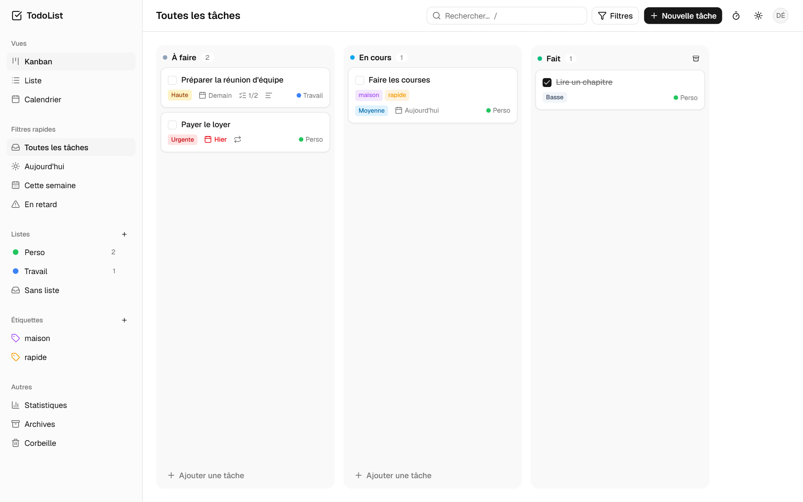
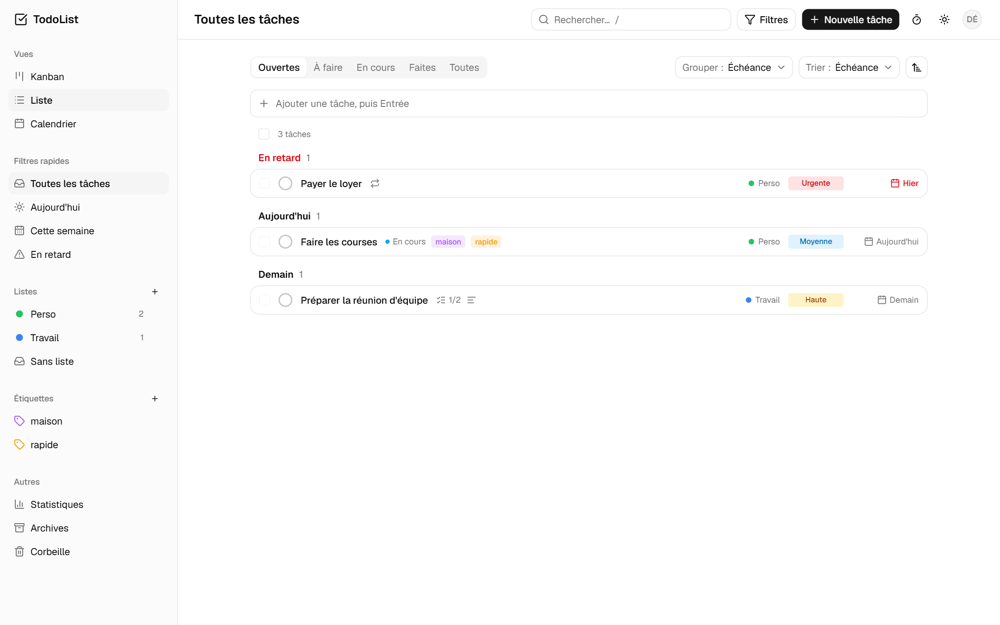
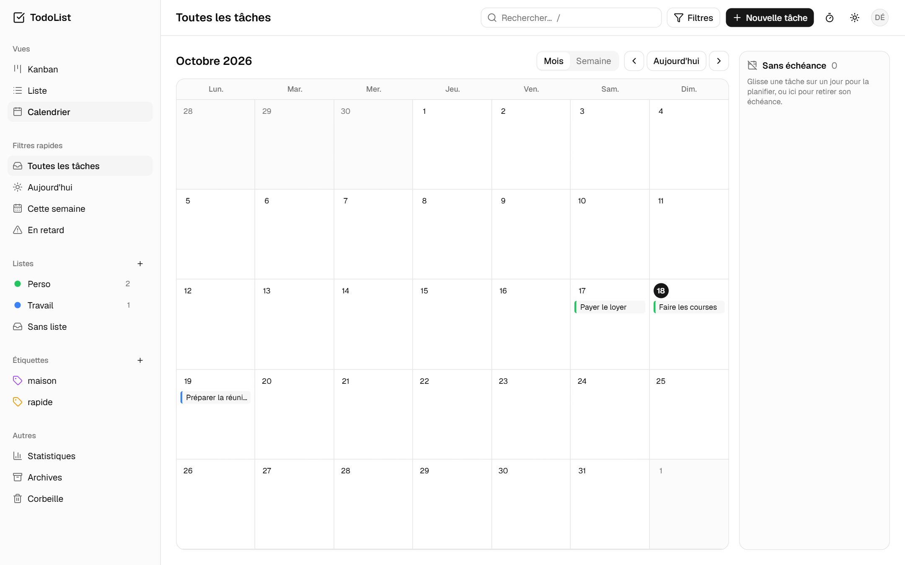
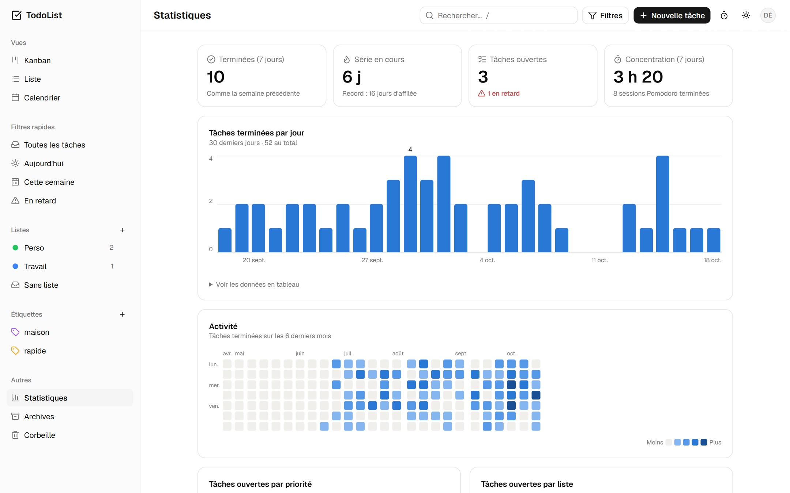
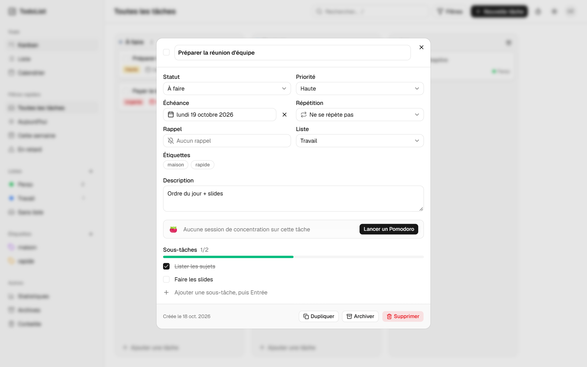
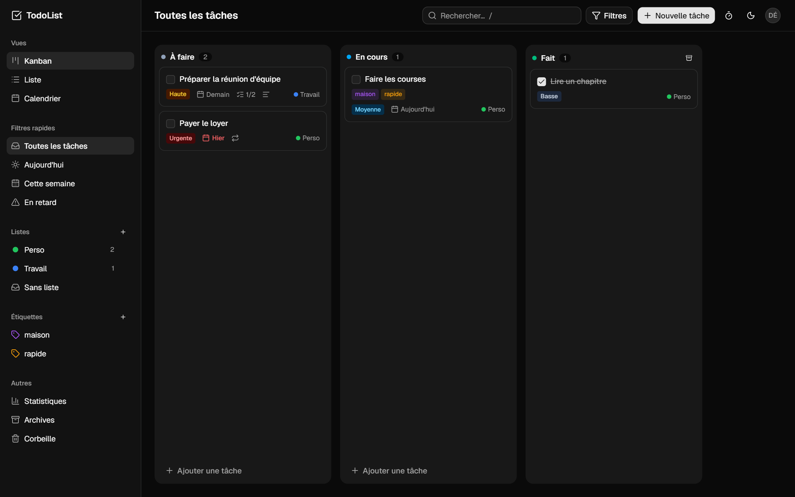
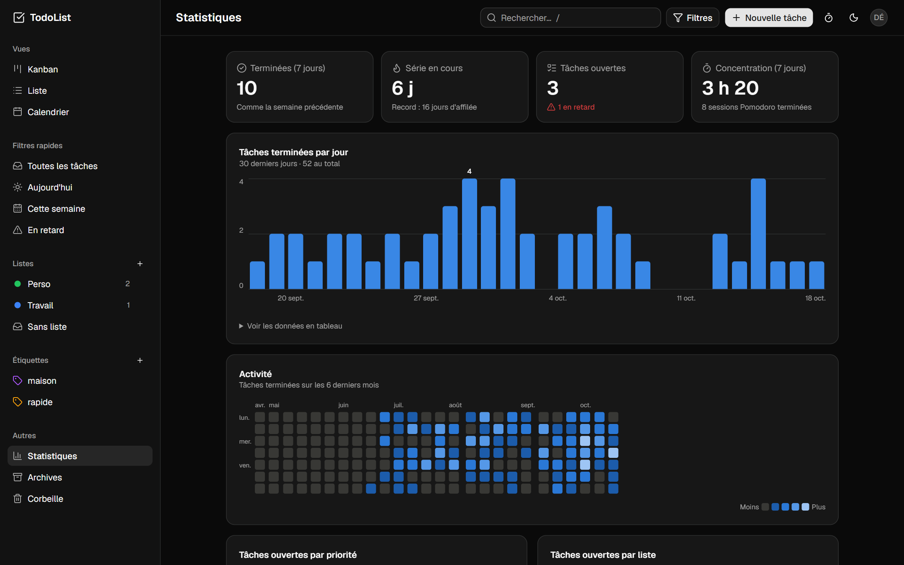
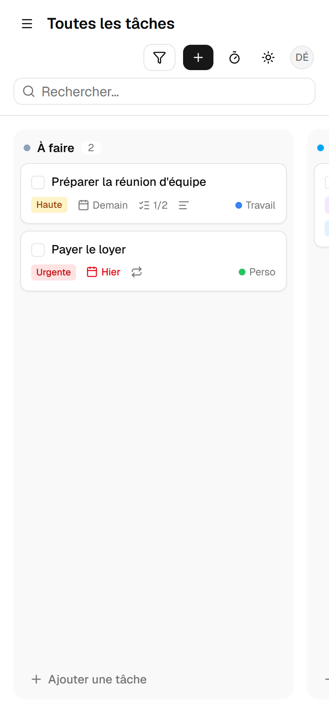
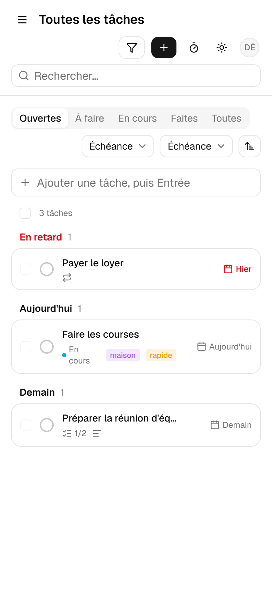
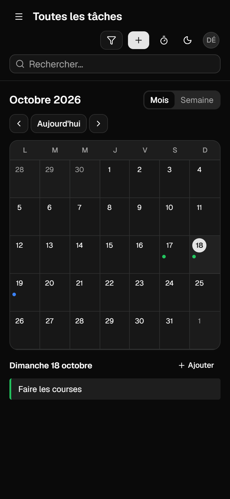

# TodoList

Application de gestion de tâches complète : Kanban, liste, calendrier, statistiques et minuteur Pomodoro.

**Démo en ligne : [todolist-umber-two.vercel.app](https://todolist-umber-two.vercel.app)** (crée un compte gratuit pour l'essayer)



## Fonctionnalités

- Comptes utilisateurs (inscription, connexion)
- Trois vues : **Kanban** avec glisser-déposer, **Liste** avec tri et regroupement, **Calendrier** mois / semaine
- Tâches avec priorité, échéance, listes, étiquettes, description et sous-tâches
- Tâches récurrentes et rappels par notification
- Recherche, filtres et filtres rapides (Aujourd'hui, Cette semaine, En retard)
- Statistiques de productivité et minuteur Pomodoro
- Archives, corbeille et annulation des suppressions
- Import / export JSON et CSV (Excel)
- Thème clair / sombre, version mobile, raccourcis clavier

## Captures

| Liste | Calendrier |
|---|---|
|  |  |

| Statistiques | Détail d'une tâche |
|---|---|
|  |  |

| Mode sombre | |
|---|---|
|  |  |

<p>
  
  
  
</p>

## Technologies

- **Front** : React, TypeScript, Vite, Tailwind CSS, shadcn/ui
- **Back** : Node.js, Express, Prisma, PostgreSQL
- **Tests** : Vitest

## Lancer le projet

Prérequis : Node.js et Docker Desktop.

```bash
npm install
cp server/.env.example server/.env
npm run db:up
npm run db:migrate -w server
npm run db:seed -w server
npm run dev
```

L'application s'ouvre sur http://localhost:5173 (compte de démo : `demo@todolist.test` / `demo1234`).
Les fois suivantes, `npm run dev` suffit.

## Mise en ligne

Le projet se déploie gratuitement sur [Vercel](https://vercel.com) (fichier `vercel.json`) avec une base PostgreSQL [Neon](https://neon.com) : il suffit de renseigner les variables `DATABASE_URL` et `JWT_SECRET`.
